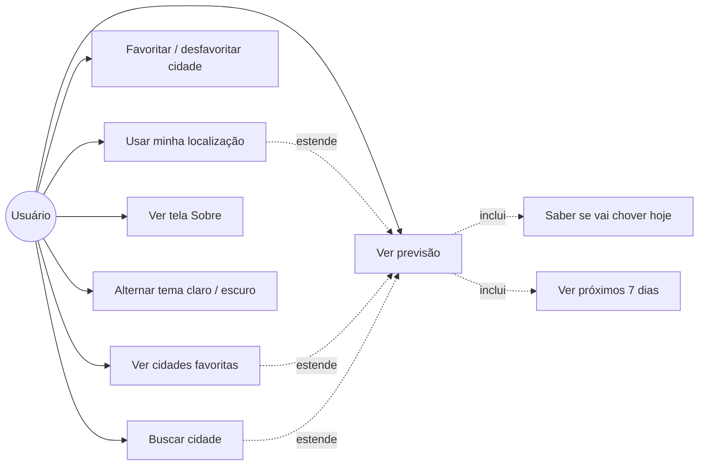
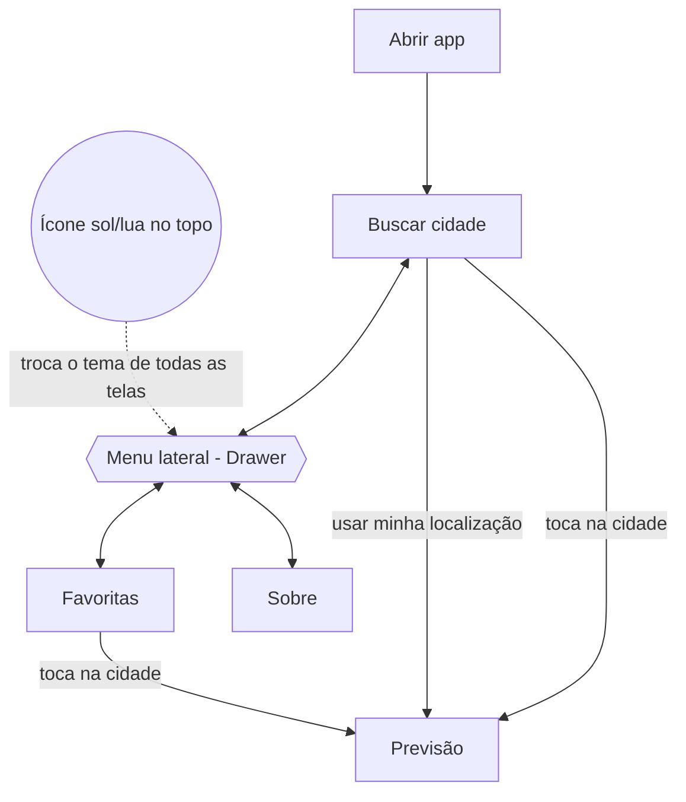
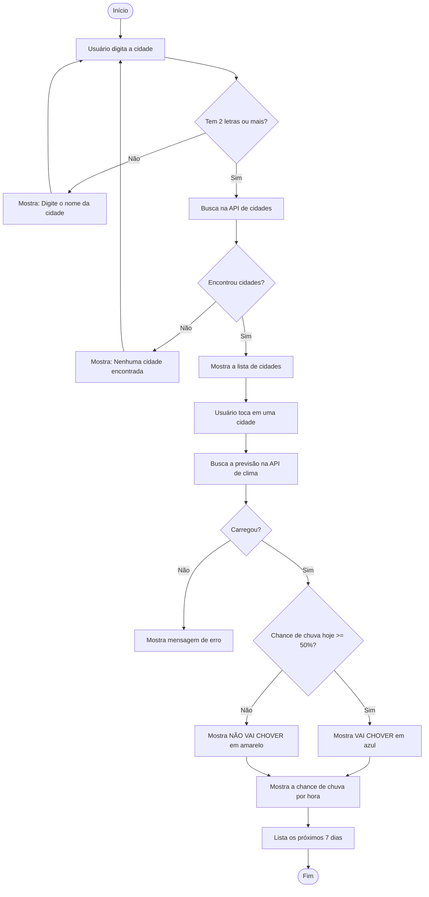
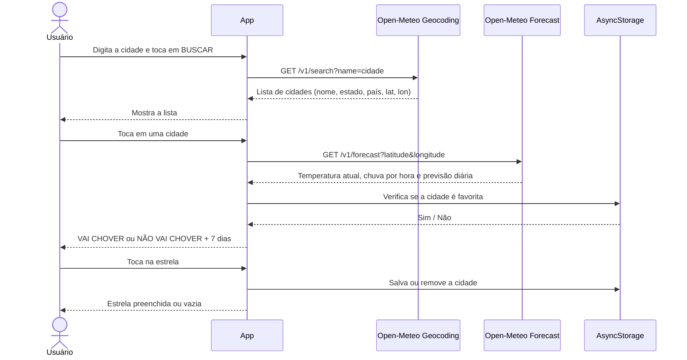
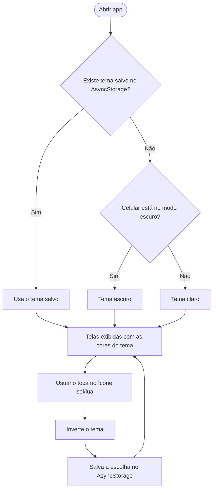
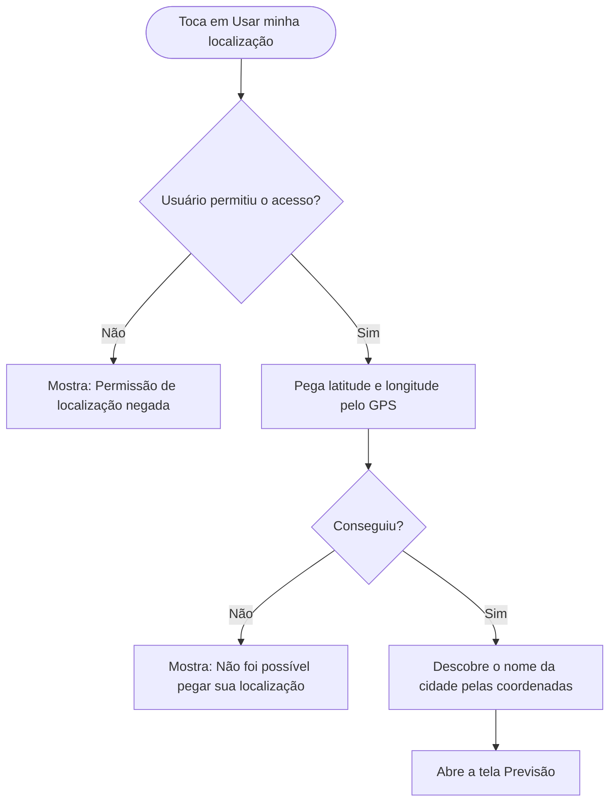
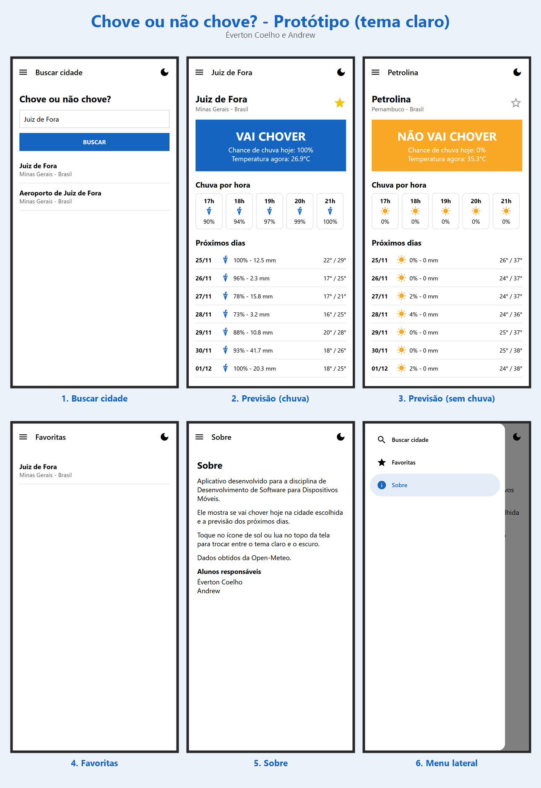
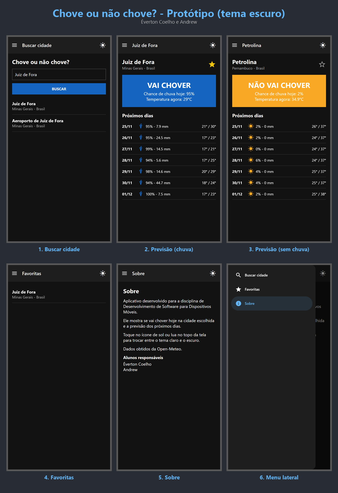

# Chove ou não chove?

Aplicativo mobile feito em React Native com Expo para a disciplina de Desenvolvimento de Software para Dispositivos Móveis.

O usuário busca uma cidade e o app responde de forma direta se **vai chover ou não** naquele dia, além de mostrar a previsão dos próximos 7 dias.

**Alunos responsáveis:** Éverton Coelho e Andrew

---

## 1. Requisitos Funcionais

| Código | Requisito | Descrição |
|---|---|---|
| RF01 | Buscar cidade | O usuário digita o nome de uma cidade e o app lista as cidades encontradas, com estado e país. |
| RF02 | Validar busca | O app não faz a busca se o campo estiver vazio ou com menos de 2 letras e mostra uma mensagem de aviso. |
| RF03 | Ver previsão | Ao tocar em uma cidade da lista, o app abre a tela de previsão dessa cidade. |
| RF04 | Informar se vai chover | O app mostra "VAI CHOVER" quando a chance de chuva do dia for de 50% ou mais e "NÃO VAI CHOVER" quando for menor. |
| RF05 | Mostrar temperatura atual | A tela de previsão mostra a temperatura atual da cidade. |
| RF06 | Previsão dos próximos dias | O app lista os próximos 7 dias com data, chance de chuva (%), quantidade de chuva (mm) e temperaturas mínima e máxima. |
| RF07 | Favoritar cidade | O usuário pode marcar ou desmarcar uma cidade como favorita tocando na estrela. |
| RF08 | Listar favoritas | O app tem uma tela com as cidades favoritas; ao tocar em uma, abre a previsão dela. |
| RF09 | Tela Sobre | O app tem uma tela com informações do aplicativo e dos alunos responsáveis. |
| RF10 | Mensagens de erro | O app avisa quando nenhuma cidade for encontrada ou quando não for possível carregar os dados. |
| RF11 | Alternar tema claro/escuro | O usuário pode trocar entre o tema claro e o escuro tocando no ícone de sol/lua no topo de qualquer tela. |
| RF12 | Chuva por hora | A tela de previsão mostra a chance de chuva (%) de cada hora que ainda falta no dia, em uma lista horizontal. |
| RF13 | Usar minha localização | O usuário pode tocar em "Usar minha localização" para ver a previsão de onde está, sem digitar a cidade. O app pede permissão antes de usar o GPS. |

## 2. Requisitos Não Funcionais

| Código | Categoria | Descrição |
|---|---|---|
| RNF01 | Plataforma | O app deve rodar em Android e iOS pelo Expo Go (Expo SDK 58). |
| RNF02 | Tecnologia | Desenvolvido em React Native com TypeScript e navegação com Expo Router (Drawer). |
| RNF03 | Dados externos | Os dados de cidades e clima vêm da API gratuita Open-Meteo, que não precisa de chave de acesso. |
| RNF04 | Armazenamento | As cidades favoritas ficam salvas no próprio celular com AsyncStorage e continuam salvas depois de fechar o app. |
| RNF05 | Conexão | O app precisa de internet para buscar cidades e previsões. |
| RNF06 | Desempenho | Enquanto os dados carregam, o app mostra um indicador de carregamento. A resposta deve aparecer em poucos segundos com uma conexão normal. |
| RNF07 | Usabilidade | A resposta principal ("VAI CHOVER" / "NÃO VAI CHOVER") deve aparecer em destaque, com cor azul para chuva e amarela para tempo seco. |
| RNF08 | Idioma | Todas as telas em português do Brasil. |
| RNF09 | Privacidade | O app não pede login nem coleta dados pessoais. O GPS só é usado quando o usuário toca em "Usar minha localização" e permite o acesso, e a localização não é salva. |
| RNF10 | Aparência | Ao abrir o app pela primeira vez, o tema segue o modo do celular (claro ou escuro). Depois que o usuário escolhe um tema, a escolha fica salva com AsyncStorage. |
| RNF11 | Legibilidade | Nos dois temas, textos, fundos e bordas devem ter contraste suficiente para leitura; os avisos azul e amarelo continuam iguais. |

---

## 3. Fluxo de funcionamento

1. O usuário abre o app e cai na tela **Buscar cidade**.
2. Digita o nome da cidade e toca em **BUSCAR**, ou toca em **Usar minha localização** para ir direto para a previsão de onde está (o app pede permissão na primeira vez).
3. O app consulta a API de geocodificação da Open-Meteo e mostra a lista de cidades.
4. O usuário toca na cidade desejada.
5. O app consulta a API de previsão com a latitude e a longitude da cidade.
6. A tela **Previsão** mostra se vai chover hoje, a temperatura atual, a chance de chuva em cada hora do dia e os próximos 7 dias.
7. Se quiser, o usuário toca na estrela para salvar a cidade nas **Favoritas**.
8. Pelo menu lateral, o usuário pode abrir **Favoritas** para ver a previsão de uma cidade salva sem precisar buscar de novo, ou abrir **Sobre**.
9. Em qualquer tela, o usuário pode tocar no ícone de **sol/lua** no topo para trocar entre o tema claro e o escuro.

### 3.1 Diagrama de casos de uso



### 3.2 Diagrama de navegação



### 3.3 Fluxograma da busca até a previsão



### 3.4 Diagrama de sequência



### 3.5 Fluxograma da troca de tema



### 3.6 Fluxograma da localização



---

## 4. Protótipo das telas

Telas do protótipo funcional (pasta `app/`):

### Tema claro



### Tema escuro



| Tela | Descrição |
|---|---|
| 1. Buscar cidade | Campo para digitar a cidade, botão BUSCAR, botão Usar minha localização e lista de resultados. |
| 2. Previsão (chuva) | Chance de chuva de 50% ou mais: aviso VAI CHOVER em azul, chuva por hora e próximos dias. |
| 3. Previsão (sem chuva) | Chance de chuva menor que 50%: aviso NÃO VAI CHOVER em amarelo. |
| 4. Favoritas | Cidades salvas com a estrela. |
| 5. Sobre | Informações do app e alunos responsáveis. |
| 6. Menu lateral | Navegação entre as telas (Drawer). |
| Ícone sol/lua | No topo de todas as telas; troca entre o tema claro e o escuro. |

### Estrutura do projeto

```
app/
  _layout.tsx    menu lateral (Drawer) e botão de tema
  index.tsx      tela Buscar cidade
  previsao.tsx   tela Previsão
  favoritas.tsx  tela Favoritas
  sobre.tsx      tela Sobre
src/
  api/config.ts  endereços da API
  context/TemaContext.tsx  cores do tema claro e escuro
  types/Cidade.ts
```

## 5. Como executar

```bash
npm install
npx expo start
```

Depois é só ler o QR Code com o app **Expo Go** no celular.

## 6. API utilizada

- Cidades: `https://geocoding-api.open-meteo.com/v1/search`
- Previsão: `https://api.open-meteo.com/v1/forecast`

Documentação: https://open-meteo.com/en/docs
